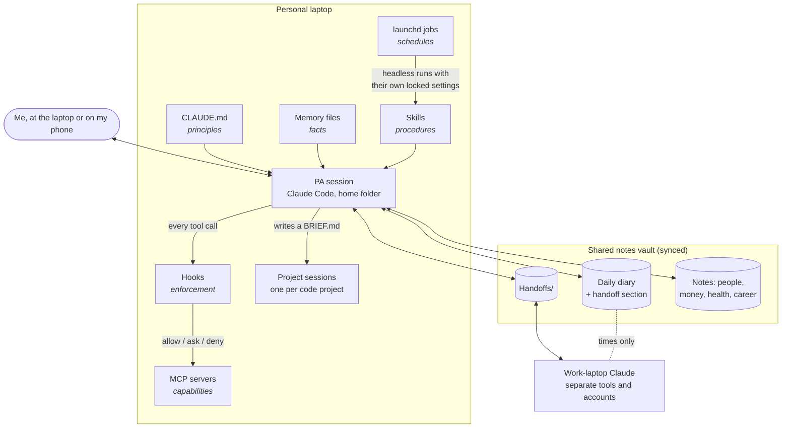

# A personal assistant built on Claude Code

[](https://github.com/erineland/claude-code-personal-assistant/actions/workflows/tests.yml)

**A case study in designing a daily-use agent system that is useful *and* safe.**

I run Claude Code as a personal assistant: it briefs me each morning, keeps a diary of my day, tracks
who I owe a reply, triages recruiter messages, reconciles my budget against my bank, and hands tasks
to a separate Claude on my work laptop. It has run every day for months, mostly while I talk to it
from my phone.

This repo is the design, not the config. It explains the architecture and the principles behind it,
lists what went wrong and what I changed, and includes generic, runnable pieces you can adapt:
five skills, four hooks, a scheduled-job pattern, and a tested reconciliation matcher. Every name and
example in it is fictional.

- [The problem](#the-problem)
- [Architecture](#architecture)
- [Design principles, each with a real example](#design-principles)
- [Lessons learned: failures and fixes](#lessons-learned)
- [Honest limits](#honest-limits)
- [What's in this repo](#whats-in-this-repo)
- [The day-job workflow](docs/work-workflow.md) (a separate write-up)

## The problem

I wanted a "guy in the chair": someone who keeps track of everything while I'm out living my life,
and hands me **one short, ranked page** instead of six inboxes. The design goal throughout is to
**reduce decision load**:

- a clear recommendation, not an open-ended menu;
- predictable shapes (the briefing always has the same four sections);
- flag changes rather than make them silently;
- the assistant does the admin, and I approve it.

That goal makes safety harder. An assistant that does the admin has to read my messages, my email
and my bank data, and has to be able to send things. So most of the design is about **what it can do
without asking, and how that is enforced**.

## Architecture



**The layers, and what goes in each:**

| Layer | Holds | Rule of thumb |
|---|---|---|
| `CLAUDE.md` | **Principles**, always loaded | Only things it would hurt to get wrong *before the model thought to look them up*. Kept lean: it's a tax on every call. |
| Memory files | **Facts**, recalled when relevant | Working figures, where things live, decisions already made, so they're never re-derived. |
| Skills (~30) | **Procedures** | Anything done twice. Each has its rules first, then steps, then traps found the hard way. |
| Hooks (8) | **Enforcement** | Any safety rule that could be checked mechanically instead of trusted to an instruction. |
| MCP servers (14) | **Capabilities** | Read-only by default, scoped to the home folder, never user-wide. |
| launchd jobs (6) | **Schedules** | Headless runs with their own minimal permission file, plus watchdogs and keep-alives. |
| Notes vault | **Thinking**: diary, analysis, notes | Documents that *prove* things live in a separate document store; the vault links to them. |

## Design principles

### 1. Least privilege, read-only by default
The messaging and file-search MCP servers I wrote are **read-only by construction**: no send tool
exists, network access is blocked, every read is audit-logged, and chats can be walled off by name
([whatsapp-readonly-mcp](https://github.com/erineland/whatsapp-readonly-mcp) is one). Personal MCP
servers are scoped to the home folder, so a coding session started inside a project folder starts
with **none** of them.

### 2. Untrusted text is data, never instructions
Messages, emails, recruiter messages and notes written by the other machine's Claude are all
treated as text other people wrote. If one seems to tell the assistant to do something (email,
pay, delete, reveal), it **surfaces it and does nothing**. Read-only servers make most injected
instructions harmless. The nightly job goes further and flags any message that reads like an
instruction to an AI in its digest.

### 3. Fail closed on money, mail and anything outward-facing
`PreToolUse` hooks force a permission prompt on every write to the budgeting app, every email send,
every outward browser action (`hooks/browser_action_guard.py`) and every smart-home change. They
**ask** rather than deny, so I stay the decision-maker. And if a hook can't parse its input, it
asks anyway. The rule I care most about (*never touch a budget transaction without a per-item yes*)
used to be one line in `CLAUDE.md`. Now a hook enforces it, so the prompt is the rule working.
See [claude-code-guardrails](https://github.com/erineland/claude-code-guardrails) for those guards.

### 4. One source of truth
Every fact has one home, and the others point to it. Working figures live in one memory file; the
recruiter criteria live in one table, which gets edited first when they change. When the same fact
was written in two places, the copies drifted apart and the assistant confidently quoted the stale one.

### 5. When you hit a gap, build the fix
A standing rule: if the assistant can't do something reasonable, it **pauses and builds the missing
piece** (a skill, MCP server, hook or script) instead of working around it. Examples: a location
link it couldn't read became a `locate` skill; a 120-second timeout on a big reminders store became a
sub-second local read-only script; a recruiter-reply rule became a hook. A suggestion table in
`CLAUDE.md` maps triggers to tools: done twice → skill, re-derived a fact → memory, a rule that
could be mechanical → hook.

### 6. One session per job
The home-folder session is the PA and never writes project code. Each project runs in its own
session inside its folder, with its own `CLAUDE.md` and no personal tools. The PA hands work over by
**writing a brief file into the project folder**, not by driving the other session. (This repo was
built that way: the PA wrote a brief, and a clean project session built it.)

### 7. A daily rhythm, and a handoff across `/clear`
Two scheduled check-ins: a morning briefing and an evening wrap. At the wrap, the assistant writes a
`🔁 Handoff` section into the diary: what's in flight, what's waiting on me, what was said but
not yet written down, and what not to re-raise. `hooks/session_start_handoff.py` prints it into any
fresh session (startup, `/clear` or compaction), so clearing context loses nothing and is never a
chore I'm nagged about.

### 8. Links, not card details
The assistant never handles payment details. For any purchase it prepares the basket and sends me
the checkout link, and I pay on my own device. The sensitive step happens in my browser session and
never passes through the transcript.

### 9. Unattended means locked down
Scheduled runs don't inherit my interactive permissions. Each gets its own settings file with a short
tool allow-list and Bash denied. The nightly notes job is limited further by
`hooks/append_only_guard.py`, which **simulates every edit** and refuses any that would change a
note's curated sections, rewrite history, create a file or touch anything outside its folders. It
fails closed: if the guard errors, the edit is refused.

### 10. Two machines, two diaries
A work laptop and a personal laptop, deliberately not sharing tools or credentials. They share a
notes folder: **times only** for scheduling (where I am, meetings, hard stops), and **handoff notes**
for tasks (`skills/handoffs`). Work content never lands in personal notes, and personal content never
reaches the work side.

## Lessons learned

These are the failures that shaped the rules above, with the fix for each.

| What happened | Why it mattered | The fix |
|---|---|---|
| An integration served transactions from a **local cache hours stale** while balances were live. A morning's analysis found a dozen "missing" items that had already landed. | Confident, wrong conclusions. | **Sync first**, always. Skills now open with the sync step. |
| A root cause was stated confidently, **twice**, from data that only covered the last year. Both were wrong. | Plausible-sounding causes are the dangerous ones. | **Check coverage before cause.** Call it a hypothesis until the full history confirms it. |
| An API delete **returned success, logged an undo entry and changed nothing**. A calendar "update" on a repeating event reported success but edited the old series master, not the occurrences. | "Done" was a lie I'd have repeated to the user. | **Re-read after every write.** For repeating events, edit with a "this and future" span and verify. |
| A reply sent by email to a messaging platform's relay **appeared in the thread as raw HTML source**: the client sent text + HTML, and the relay showed the HTML. | Embarrassing in front of a stranger. | Hand the user the text to paste in the app until there's a true plain-text route. |
| A nightly job **"finished" for 12 nights having read zero messages**: an OS permission grant was tied to the binary path and silently lost on an update. | Messages on a disappearing timer were nearly lost. | A start-of-run check that **actually reads** the data, aborts loudly if it can't, and a machine-readable `RESULT … read=N` last line. |
| A password typed in **prose** ("the password is …") passed through `NAME=value` redaction into the notes vault. | Secrets in synced notes. | Prose and form-field redaction patterns, exact-value matching against live secrets, and hashed matching for rotated ones. |
| Asking a calendar integration for "every calendar" at once **silently returned nothing**. | An empty day that wasn't. | Query per calendar; treat empty results as suspicious. |
| While I was abroad, a flight time was shown in the laptop's timezone, **an hour off**. | Nearly missed a departure window. | Convert every time to local and label it; verify flights on a live tracker. |
| A meeting tool's auto-summary **invented a fact** about me. | Notes become fiction. | Always read the transcript; flag garbled names rather than guess. |
| Hand-adding "missing" recent transactions **raced the bank import** and created duplicates. | More mess to clean. | Don't hand-add anything from the last ~3 days. |
| Two copies of the same fact drifted. | The model quoted the stale one. | One source of truth; point, don't copy. |

## Honest limits

- **It's built for one person.** It isn't multi-user, and the skills encode my preferences. The
  pieces here are templates, not a product.
- **There are no formal evals.** Skills improve through use and through the traps they collect, not
  through a test harness. Only the deterministic parts (hooks, the matcher) have unit tests.
- **Hooks guard actions, not judgement.** They stop an unapproved send; they don't stop a bad
  draft or a wrong conclusion. "Untrusted text is data" is enforced structurally only where the
  tools are read-only. Elsewhere it relies on the model following instructions.
- **It depends on a laptop that's awake**, desktop apps that are open, and OS permission grants that
  can vanish on an update. Keep-alive jobs and watchdogs reduce this; they don't remove it.
- **The surface is big for one person to maintain.** About 30 skills drift as the services they call
  change. I prune regularly and archive what isn't used.
- **It isn't free.** I track a rough per-day energy estimate (with a range, not a precise figure)
  and keep the always-loaded instructions lean.

## What's in this repo

```
README.md                         the case study (this file)
docs/work-workflow.md             how I ship at my day job with Claude Code (patterns only)
skills/
  daily-briefing/SKILL.md         the ranked briefing, the diary, the daily rhythm and handoff
  handoffs/SKILL.md               task passing between two machines, with a template
  recruiter-triage/SKILL.md       score, track, draft; a single hook-gated send path
  people-notes/SKILL.md           living per-person notes; log-only automation at night
  reconcile/SKILL.md              bank ↔ budget method and its failure patterns
  reconcile/lib/match.py          the matcher: widening tolerance, running gap, self-check
hooks/
  session_start_handoff.py        hand a fresh session yesterday's handoff
  session_end_digest.py           a one-page, searchable digest of each session
  append_only_guard.py            unattended edits may only add to a note's log
  browser_action_guard.py         outward-facing browser actions ask first
  settings.example.json           wiring
scheduled/
  example.nightly.plist           a headless nightly run as a launchd agent
  unattended-settings.example.json  that run's own locked-down permissions
examples/2030-01-15-diary.md      a fictional day: briefing, diary, handoff
tests/                            unit tests for the hooks and the matcher (run in CI on every push)
SECURITY.md                       how to report a way around a guard
```

**Try it:**
```bash
python3 -m unittest discover -s tests -v
python3 skills/reconcile/lib/match.py --gaps bank.csv ledger.csv
```
To use a hook, copy it to `~/.claude/hooks/`, set the environment variables in its docstring and
merge `hooks/settings.example.json` into `~/.claude/settings.json`. Read every line first: hooks run
as you.

**Related:** [claude-code-guardrails](https://github.com/erineland/claude-code-guardrails) (fail-closed
guards for money and mail, transcript export with redaction, a rate-limit status line) ·
[whatsapp-readonly-mcp](https://github.com/erineland/whatsapp-readonly-mcp) (a read-only messaging
server designed against prompt injection).

MIT licensed.
