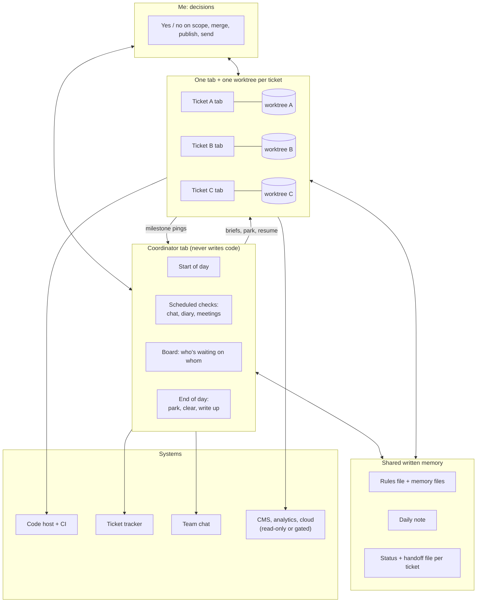

# How I ship at my day job with Claude Code

> **This is a description of a workflow, not a release of it.** It's written fresh, in my own words,
> to show the patterns. It contains no code, prompts, skill text or configuration from my day job, and
> it names no employer, product, colleague, ticket, repository, channel or business figure. The
> example day near the end is invented.

I'm a senior engineer on a product engineering team. My work laptop runs its own Claude Code setup,
separate from the personal assistant in this repo but built on the same ideas. The short version:

- I work as **one coordinator plus several specialists.** One Claude Code tab coordinates (briefings,
  chat triage, tickets, PR state, scheduling) and never writes code. **Every ticket gets its own tab
  in its own git worktree.**
- The tabs share **written memory, not chat history**: rules files, one-fact memory files, a daily
  note, and a status file plus a handoff file per ticket. That's what lets work survive overnight,
  across tabs, and across `/clear`.
- **Speed comes from parallel, isolated work. Safety comes from gates.** The AI drafts, tests, builds
  and verifies. It cannot merge, push to a base branch, publish, deploy or send a message without my
  explicit yes, and the riskiest of those are blocked in settings, not just in instructions.
- **I'm deliberately the bottleneck** for every decision that matters (scope, merge, publish, send).
  The system exists to make those decisions fast and well informed, not to remove them.

## 1. The shape

## 2. The building blocks

### Sessions: a coordinator and specialists
| Session | Its job | What it never does |
|---|---|---|
| **Coordinator** | Morning briefing, calendar, mail, chat triage, ticket and PR state, starting ticket tabs, collecting their reports, keeping the daily note current | Edit source code or commit |
| **Ticket tab** (one per ticket, or per small epic) | Read the ticket fully, propose scope, test first, open a draft PR, watch CI, fix, document | Merge, push to a base branch, publish, deploy, message people |
| **Meeting tab** (occasional) | A live copilot: reads the transcript on demand, suggests the next question, fact-checks | Speak for me |

Each ticket tab is named and coloured, and its **status line shows where the ticket is in the cycle**
(plan → build → draft → reviewed → fixing → in review → ready to merge → merged, plus CI and conflict
flags). The stage is worked out from git and the code host by a script, so it costs no tokens.

### Isolation: one worktree per ticket
Every ticket gets its own worktree **outside** the repo folder, its own branch off the integration
branch, and its own dependency install. Parallel tabs never touch each other's files. (Worktrees
nested *inside* the repo folder broke the front-end build with duplicate copies of a library, so
they live alongside it instead.)

### Shared written memory
| Layer | What lives there | Loaded |
|---|---|---|
| Global rules file | Safety rails, writing rules, how to explain things to me, standards of evidence | Every call, every tab |
| Repo rules file | Codebase facts, the test map, conventions | Every call in that repo |
| Memory files (one fact each, indexed) | Tool quirks, past gotchas, decisions | When relevant |
| Daily note | A running log every tab appends to: findings, decisions, PRs | Read at start of day, appended all day |
| Ticket status file | 4 lines: updated · problem · just did · next/blocked | Overwritten at every hand-back |
| Ticket handoff file | A full handoff for a parked ticket, checked against git | Injected by a startup hook after `/clear` or on pickup |
| Evidence log | One factual line per real win | Appended at end of day |

**Git and the code host are ground truth.** If a status file disagrees with git, git wins.

### Communication between tabs
- The coordinator sends each new ticket tab a **grounded starter brief** (ticket summary, prior work,
  the rules that apply) as a direct session message, never via the clipboard.
- Ticket tabs send back **one-line milestone pings** ("PR raised (draft) · next: CI, then device test").
- The coordinator asks to be told when a tab goes idle, instead of polling.
- **A message from another tab is never my approval.** Each tab still asks me before any gated action.

### The day's rhythm
| When | What runs | Output |
|---|---|---|
| Start of day | Start-of-day procedure | Daily note; calendar, mail, chat, tickets, PRs; checks that cloud sign-ins are still valid; lists parked tickets and resumes each open tab; schedules the day's checks |
| A few times a day | Chat check, run by a cheaper model in a subagent | A "who asked what" table in the daily note, linked to tickets |
| A few times a day | Board snapshot | A sessions table in the daily note: last done · next · waiting on |
| After each meeting | Meeting check | Meeting note, decisions, draft ticket comments |
| End of day | End-of-day procedure | Every tab reports and **parks**; the coordinator clears the safe ones; summary, evidence log, reminders |

### The ticket lifecycle
1. **Start the ticket** (from the coordinator): read the whole ticket, comments and linked docs;
   create the worktree; install; open the editor and a named tab in plan mode; send the brief.
2. **Scope first.** The tab writes requirements, exceptions, what *not* to change and open questions,
   then **waits for my confirmation**.
3. **Detective trail.** Its first task is to show me how the code works today (the search and the
   file:line chain), so I understand it before anything changes.
4. **Test first.** Write a failing test, run it, see it fail, implement. A test suite isn't trusted until
   a deliberately wrong implementation makes it fail (a mutation check).
5. **Draft PR at the first real commit**, shown to me first. The ticket link stays out of the PR body
   until it's ready, because the link moves the ticket automatically.
6. **CI watch** after every push. On red: read the error, reproduce locally, fix test first. Nothing is
   re-run until it's green without a *named* flake.
7. **Deep code-quality review.** It asks my risk appetite first, then routes each finding to fix now,
   a follow-up ticket, or drop.
8. **Merge gate.** I explain the change in three sentences in my own words (what, why, what would
   break it), and Claude checks them against the real diff.
9. **I merge.** The AI is blocked from merging in settings.
10. **Deploy** (staging, then production) and **verify on the live site** with the authoritative tool.
11. **Park and pick up** if a ticket spans days. When it's done, a **retro** sends each learning to its
    home: a memory, a skill, a check, or the rules file.

## 3. Skills: procedures written down once
| Area | What the skills do |
|---|---|
| Day and coordination | Start and end the day, the board, chat triage, saving drafts, preparing for and processing meetings, a live meeting copilot |
| Ticket flow | Start, park, pick up, deep review, merge gate, retro, a self-quiz on a change, progress reports |
| Gated changes to live systems | Tag-manager and analytics configuration changes, CMS content fixes, redirect validation |
| Verification | Browser automation, local-vs-live comparison, performance audits, tracking checks, recording demos, screenshots for docs |
| Access upkeep | Re-authenticating expired cloud and analytics sign-ins |

**Every gated skill follows one pattern:** plan read-only → show the plan with a hash → apply only
after I say yes to *that exact hash* → read every change back → keep a rollback path.

## 4. Hooks and scripts: the mechanical glue
- **Resume on start:** loads a parked ticket's handoff and live git state into a fresh session, and
  warns if git moved since the park.
- **Stale-handoff nudge:** after a ticket is parked, if later work made the handoff stale, the tab is
  asked once to refresh it.
- **CI watch after push:** every push prompts a background watcher that hands back only when all
  checks finish.
- **Follow edits:** each edit opens in that worktree's editor at the changed line, so I see the code
  change as it happens.
- **Safe clear of a parked tab:** `/clear` is typed into a parked tab only after six checks pass (fresh
  handoff, HEAD unchanged, no work after the park, every dirty file accounted for, exactly one idle
  tab, empty input box).
- **Board and stage scripts:** one glance at every worktree, PR, CI state and parked ticket.
- **Tokens per merged PR:** a weekly measure of spend per shipped change.

## 5. Safety rails: what the AI can't do
| Rail | How it's enforced |
|---|---|
| No PR merges without my yes for that PR | **Denied in settings** (merge commands, pushes to base branches) |
| No commit or push without showing the diff and getting a yes | Rule in the rules file, followed by every tab |
| No silent merge-conflict resolution | Both sides shown; I decide; a tab executes. Automatic conflict resolution is denied |
| No message sent for me | Drafts are saved **unsent, in place** in the exact conversation or thread; I press send. Every draft is also logged, so nothing is lost to the clipboard |
| No change to live configuration, content publishing or deploys without me | Gated skills with plan hashes; publish and deploy stay mine |
| Read-only access to cloud and analytics consoles | Rule plus credentials scoped to read |
| No secrets in the transcript | A password-manager CLI injects them at run time; they're never pasted into a chat |

**I also security-reviewed my own setup.** It was a read-only pass, with parallel reviewers for
permissions, credentials, supply chain and exposure, and every serious finding re-checked against a
primary source. The lessons that apply to anyone:
- broad allow rules on a whole CLI are a path to consequential actions, so put user-scope ask rules and a narrow hook on the dangerous verbs;
- pin third-party MCP servers to exact versions;
- a token printed once lives on in transcripts and backups, so rotate it and then delete the copies;
- bind dev servers to localhost;
- extension points can outrank deny rules on an unmanaged machine;
- retire old background sessions.

## 6. How quality stays high at speed
- **Check, don't assume.** Every claim is tagged: confirmed by a test, confirmed by a primary source,
  hypothesis, or interpretation.
- **A cause needs a counterfactual.** Example: several PRs had red preview builds at once. The logs
  showed the CMS rate-limiting while many builds ran concurrently, and rebuilding one PR *alone* on
  the same commit passed. That turned a guess into a cause, and gave a rule: rebuild one at a time.
- **Read after write.** Never trust a write response; re-read the state and show before and after.
- **Mutation checks** prove a test can fail.
- **Second opinions** on safety calls come from an independent path: a subagent given the question,
  not my conclusion.
- **Positive controls for negative results.** For example, proving a draft was *not* sent by reading
  the thread.

## 7. Staying connected to the code
High output carries a real risk: shipping code I couldn't explain. The countermeasures are the
detective trail at the start of every ticket, the merge gate before every merge, edits opening in my
editor as they happen, a self-quiz on a change, and explanations written for how I learn (a one-line
answer first, then cause and effect in order, real values shown, confirmed versus inferred labelled).
The merge gate's first run caught a real gap: I described a follow-up change instead of what the PR
actually contained. The tip that came out of it: read the file list first, because the biggest
additions say what a PR is really about.

## 8. Cost
- Cost is roughly *calls × context size*, so a bloated always-loaded rules file is a tax on every
  call. I had a read-only subagent propose a section-by-section cut list (keep / trim / move to a
  skill or memory / delete) and approved it group by group: **principles in the rules file,
  procedures in skills, facts in memory.**
- **Park, clear, resume:** a parked ticket restarts from a small handoff instead of a huge context.
- **Delegate reading-heavy sweeps** (chat triage, docs lookups) to cheaper subagents. The coordinator
  keeps the conclusion, not the dump.
- **Measure spend per shipped, verified change**, not spend per day.

## 9. An example day (invented)
| Time | What happens |
|---|---|
| 09:15 | Start of day: briefing, parked tickets listed, checks scheduled. Several PRs show red preview builds |
| 10:30 | Cause found and proved with a solo rebuild: a shared rate limit under concurrent builds |
| 10:45 | First PR merged (an accessibility contrast fix) after the merge gate |
| 11:00–14:30 | Changelog conflicts shown side by side and resolved by tabs on my yes; a second PR merged |
| 12:30 | A small new safety tool built in its own tab |
| 15:00 | New ticket started: worktree, tab and grounded brief in a couple of minutes |
| 16:30 | A cross-team request answered: an "options only, no commitments" reply drafted unsent in place; I edited it and sent it |
| 17:00 | Two more PRs merged; an analytics configuration change published through a gated skill |
| 17:30 | Staging and production deploys, verified on the live site |
| 18:00 | Every tab reports and parks; the coordinator clears the safe ones |

**Roughly:** several PRs merged and live in a meeting-free day, with a couple more opened.

## 10. Analysis

### Why it multiplies output
1. **Parallel work without collisions.** Worktrees isolate the code; one tab per ticket isolates the
   context. While one ticket waits on CI or a designer, another moves.
2. **Context that survives.** No tab starts from zero, and nothing depends on one long chat.
3. **Coordination is a procedure**, not my attention.
4. **Verification is mechanised**, so my review time goes on judgement, not typos.
5. **Gates make speed safe.** Because merges, publishes and sends need me, the AI can move fast everywhere else.

### Where the human stays, and why that's right
Scope and trade-offs, merge decisions, publishing to live systems, and anything said to a person.
These carry accountability. The system's job is to make each one a fast, well-informed decision.

### Weaknesses I've actually hit
| Risk | What it looked like | Mitigation |
|---|---|---|
| **Breadth beats depth** | Too many tabs at once; I became the bottleneck for every yes, and felt disconnected from the code | Merge gate; about two PRs in flight; fewer tabs on purpose |
| **Shared bottlenecks** | Parallel builds hit a rate limit; every PR conflicts on the changelog | One build at a time; merge, then update the next PR |
| **Sequencing gaps** | Tracking reached production before the analytics fields it relied on were registered | A "what must exist before prod?" question at the merge gate |
| **AI errors** | Answering the wrong question; missing a linked document; a made-up link (caught and fixed) | Restating the ask, source tags, read-after-write, my review |
| **Tooling overhead** | Building tooling is satisfying and can crowd out product work | Track the share; tie tooling to a team outcome |
| **Config fragility** | A running session can overwrite a shared config file | Quit sessions before config edits; back up before every change |
| **Cost visibility** | Spend is easy to see, value less so | Measure per merged PR, not per day |

### If you want to copy this, start here
1. **One worktree per ticket**, outside the repo.
2. **A rules file with hard safety rails**, with the risky ones enforced as deny rules.
3. **Test first, with a mutation check**, as the default.
4. **A status file per ticket and a daily note** that every session appends to.
5. **A merge gate:** explain the change in your own words before you merge.

Add the coordinator tab, scheduled checks and park/resume once those feel natural.

## 11. Two machines, two diaries
The personal assistant in this repo runs on a different laptop. The two share a notes folder and
nothing else: the personal side reads the work note for **times only** (where I am, meetings, hard
stops), and tasks cross as handoff notes (`skills/handoffs`). Work content never lands in personal
notes, and personal content never reaches the work side.
